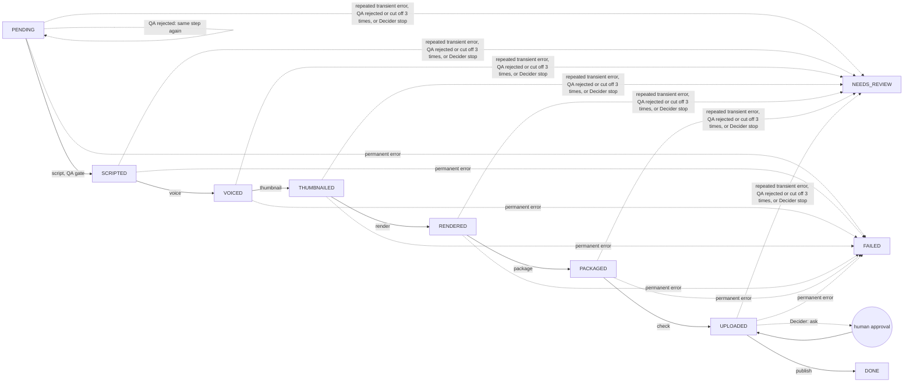

# sleepy-agent

A small agentic AI system built in public, from scratch, in Go. No agent
framework. The goal is to learn what actually works when an AI system has to
reason, use tools, make decisions and take action, and to share the
architecture, the failures and the trade-offs along the way.

The code is being extracted piece by piece from Sleepy, my own project that
already produces sleep-narration videos, and wrapped in an agent layer. The
running example is an automated episode pipeline: a topic goes in, an
episode (title, script, later narration and video) comes out, with quality
gates, self-healing and human approval where it matters.

> Status: **Day 6 of 11.** The state machine and worker loop are ported from
> Sleepy, and a walking skeleton runs a mock episode end to end. Scripts come
> from the ported Sleepy generator and pass a QA gate before the run may
> advance: a rejected script is retried, then parked for a human. Publishing
> waits for a human.

## Run it

Needs Go 1.23 or newer. No API key, no network.

```bash
make skeleton # one mock episode through the state machine: the QA gate rejects a short script once, publish waits for approval
make demo     # the agent loop; scripted mock, or a real model if GROQ_API_KEY and GROQ_MODEL are set
make script   # generate scripts with the ported generator, measure the raw failure rate and what the QA gate would say (needs GROQ_API_KEY and GROQ_MODEL for a real result; MAX_TOKENS and REASONING_EFFORT low|medium|high, for gpt-oss, change the token budget and reasoning)
make compare  # native vs prompt based tool calling, N runs each (needs GROQ_API_KEY and GROQ_MODEL for a real result)
make test     # tests with the race detector
make lint     # gofmt and go vet
```

## How a run moves

One worker iteration claims a run, does exactly one step, and releases it. The
status is the only memory, so a crashed run resumes from the step it was on
(tested by reopening the state file with brand new objects).



Not built yet, but where it goes: a fix engine that tells the model why it was
rejected (Day 7), QA gates for voice, render and package once those adapters
are real (Day 10), budgets and autonomy levels (Day 9).

Design rules the code follows:

- **One seam to the model.** Everything talks to `llm.Provider`. The mock,
  Groq and OpenAI are interchangeable, and tests never need a network.
- **Deterministic first.** Rules live in code (QA gates, fix catalog), not in
  prompts. The LLM only handles judgment calls that cannot be coded.
- **Earn autonomy.** A new capability starts in shadow mode, where it only
  suggests. It gets control after the logs show it deserves it.
- **Act, ask, stop.** Before every step the worker asks an `agent.Decider`.
  There is no implicit permission, and an unknown answer means stop.
- **Publish safely.** `Voice`, `Renderer` and `Publisher` are interfaces with
  mocks. The publisher defaults to dry-run; a real upload is unlisted and needs
  approval. Nothing goes public without an explicit autonomy policy.

## Repo layout

| Package | What it does | From Sleepy? |
| --- | --- | --- |
| `internal/agent` | Agent loop, tool schemas and validation, `Decider` (act, ask, stop) | new |
| `internal/llm` | `Provider` seam, mock, OpenAI compatible client (Groq) with native tool calling, `PromptTools` adapter for models without it | new |
| `internal/tools` | Tools the agent can call: policy, word count, repetition | new |
| `internal/domain` | Run model and the status chain | ported |
| `internal/runner` | Worker loop, QA gate and approval gate, adapter interfaces and mocks | ported, reduced |
| `internal/qa` | The script QA gate: word count, banned phrases, sleep safety, title. Says pass or fail and why, repairs nothing | ported |
| `internal/store` | Run storage: memory or JSON file | new (Sleepy uses Postgres) |
| `internal/policy`, `internal/errs` | Duration limits, transient error type | ported |
| `internal/script` | Script generator ported from Sleepy (chunked, same prompts) and `Measure`, which counts broken prompt rules without judging | ported |
| `internal/scenario` | The one task `demo` and `compare` share, so both measure the same thing | new |
| `cmd/demo`, `cmd/skeleton`, `cmd/compare`, `cmd/scriptstats` | The agent loop demo, the walking skeleton, the adapter comparison, the script failure rate | new |

## Known limits (measured, see FAILURE_LOG.md)

- The script step has a QA gate (`internal/qa`, Sleepy's thresholds). A rejected
  script is run again as the same request, up to 3 failed attempts in a row
  (rejections and errors share one counter), then the run is parked for a human.
  The retry does not tell the model why it was rejected, that is the fix engine
  on Day 7. Voice, render and package have no gate yet, they arrive with the
  real adapters. `Measure` (the prompt's strict rules) and the gate
  (production thresholds) are separate on purpose: a script can be clean for
  `Measure` and still be rejected.
- Raw script failure rate with no retry and no gate (`make script`, one prompt,
  so not a general claim). `qwen/qwen3.8-27b`, Earthside, 5 minute episodes, 7
  scripts: 0 of 7 clean. The structure held (4 sentences per paragraph, 12 to 14
  paragraphs) but sentences were 5 to 7 words on average instead of 8 to 20, so
  scripts had about 314 words against a 500 minimum; all 7 broke `too_short`
  and `sentence_not_8_to_20_words`. `openai/gpt-oss-120b`, 3 runs per setting: the
  default budget (1500 tokens) and a 4000 token budget both returned no script
  text in 3 of 3 runs, with all but 2 completion tokens spent on hidden
  reasoning. With `reasoning_effort` low a script came back in 5 of 6 runs, and
  the gate accepted 2 of those 6 attempts. Table and caveats:
  `docs/script-reasoning-budget.md`. A reply cut off by the token limit
  (`finish_reason: length`) is a generation error that is retried like a QA
  rejection (the same counter, 3 failed attempts in a row, then NEEDS_REVIEW).
  The cut off text is dropped, never used as a script. Not measured: why the model reasons up to
  the limit with this prompt, and why Qwen ignores only the sentence length
  rule.
- The gate on real output (`make script`, `qwen/qwen3.8-27b`, 3 scripts, one
  attempt each): 1 of 3 accepted. Two were rejected `WORDCOUNT_LOW` (387 and 343
  words), one of them also for the banned word "disappear". The accepted script
  had 657 words, but 32 of its 84 sentences were under 8 words and one
  sentence appeared twice; the gate checks neither (it holds Sleepy's
  thresholds, not the prompt's rules). Length also varied between runs of the
  same model (about 314 words on average over the first 7 scripts, 462 here),
  so no single run gives a stable rate.
- Tool calling is model specific, measured with `make compare` (5 runs per
  mode, one task, so not a reliability claim). `gpt-oss-20b` and `gpt-oss-120b`:
  native 5/5, prompt based 0/5 (HTTP 400 on Groq). `qwen/qwen3.8-27b`: 5/5 in
  both modes, native used about 1.9x the tokens (3241 vs 1718 per run). The
  cause of the token difference is not measured. Full tables: `docs/tool-calling-comparison.md`.
- A step that crashes in the middle is run again from its start. Idempotency
  (input hashes) arrives on Day 7.

## Plan (living, it changes when something fails)

| Day | Focus |
| --- | --- |
| 1 to 2 | Launch, repo, provider seam, mock provider, first measured failure |
| 3 | Agent loop, tools with validation, `Decider` (act, ask, stop), Groq provider |
| 4 | State machine, worker loop and a `Store` (memory or JSON file) ported from Sleepy; walking skeleton with mock adapters and a publish approval gate |
| 5 | Real script generation: Sleepy's script generator ported, the script step runs on a real LLM; first measured raw failure rate, with no QA yet |
| 6 | Script QA gate ported (Sleepy's thresholds); a rejection is retried, then parked for review; the known gap tests flip to reject and the naive pipeline is removed |
| 7 | Idempotency (input hashes) and FixEngine; Postgres behind `Store` only if needed |
| 8 | Shadow-mode LLM reasoner and evals |
| 9 | Approval gates, autonomy levels, guardrails (budget, attempts, allow-list) |
| 10 | Real voice, render and YouTube adapters, first real upload as unlisted behind approval |
| 11 | Launch: CI, Docker compose, one-command demo, walkthrough |

Every day's failures are written down in [FAILURE_LOG.md](FAILURE_LOG.md).

## License

MIT
